# Extended experimental results

This supplement develops the evidence behind the Carrying → Matching → Copying account: how predecessor information reaches a historical value's key, how a receiver selects and copies that value, how architecture and early training allocate these functions, and how the resulting models behave on natural text. It includes the full sweeps and numerical comparisons accompanying the paper's compact presentation.

**Reading guide:** [setup and probes](#s1-setup-and-measurement) · [association specificity](#s2-association-specificity) · [selection and source-key paths](#s3-selection-and-source-key-paths) · [source access and copying](#s4-source-access-and-copying) · [allocation controls](#s5-architecture-and-training-shape-allocation) · [formation](#s6-circuit-formation-through-training) · [pretrained models](#s7-pretrained-qwen-localization-and-restoration) · [natural-text outcomes](#s8-natural-text-prediction-and-recall) · [alternative receivers](#s9-alternative-receivers)

Figures appear inline and link to their original vector PDFs. Each numerical table has a CSV download. Layers and heads are zero-indexed. **Carrying** is named **Bind** in legacy data files and CLI commands; **Matching** is named **Match**. These names refer to the same probes.

## S1. Setup and measurement

### Architecture, training, and replication

The controlled comparison places full-attention receivers at L3/L7 and changes the blocks that prepare their historical inputs. The eight-layer models have width 512, FFN dimension 2,048, and eight heads. SWA window size includes the current token.

**Controlled architecture configurations.** [CSV](configuration.csv)

| Model | Layout | Heads | Parameters |
| --- | --- | --- | --- |
| GDN hybrid | [GDN³, FullAttn]² | 8 | 78.88M |
| SWA hybrid (window 4) | [SWA₄³, FullAttn]² | 8 | 77.26M |
| Transformer | FullAttn⁸ | 8 | 77.26M |
| SWA window 2 | [SWA₂³, FullAttn]² | 8 | 77.26M |
| SWA window 8 | [SWA₈³, FullAttn]² | 8 | 77.26M |
| SWA window 16 | [SWA₁₆³, FullAttn]² | 8 | 77.26M |
| GDN convolution width 2 | GDN hybrid, kernel 2 | 8 | Baseline GDN count −24,576 |

All controlled models add learned absolute position embeddings before the first block. Full-attention RoPE is disabled; SWA additionally applies RoPE to Q and K. The 16-layer model uses the same position-embedding design.

Training uses GPT-2 tokenization, packed 1,024-token OpenWebText sequences, effective batch size 64, bfloat16, AdamW with β=(0.9, 0.95), peak learning rate 3×10⁻⁴, 1K warmup steps, cosine decay to 3×10⁻⁵, and gradient clipping at 1.0. Standard duration is 30K steps. Early LR ×0.1 scales the **learning rate** of all parameters in the selected blocks, including mixer, FFN, and normalization, through 3K steps for GDN and 4K for SWA. The common schedule then resumes with optimizer moments preserved.

Principal architecture, window, and training-stream comparisons use runs 42/43/44. Layout-matched Transformer LR reduction uses matched runs 42/43; auxiliary Transformer LR subsets use run 42. A table listing individual runs reports per-run values; replicated summaries report the mean and **sample** SD across runs. Bootstrap intervals resample paired prompts within one checkpoint.

**Archived measurement sizes.** The results below retain their original experimental protocols: synthetic probes and factorial conditions use 200 paired prompts per model/run/checkpoint/condition; the GDN two-dimensional sender×edge dose sweep uses **60 prompts per dose cell**; natural-text PPL uses **10,000 sequences per checkpoint**; natural-text head ablation uses 200 sequences. The release's 200-sample CLI defaults apply to fresh evaluations.

### Paired prompts and exact patching operations

A clean prompt has the form `AB … CD … A_query`; B is the target, D the distractor, s the historical B position, and q the query. The outcome is the logit margin `m = z_B − z_D`. Prompts contain 1,020 tokens, with q=1019, needle IDs 3000–3199, and filler IDs 500–2999. Sample d uniformly from the integers 300–699; place the distractor key at r₂=q−d and the target key at r₁=max(2, r₂−max(8, floor(d/2))), followed by their values. Each donor copies its paired clean prompt and changes only the specified keys.

For a block update `u = output − input`, the patched donor is `ũ_d = u_d × RMS(u_c) / (RMS(u_d) + 10⁻⁸)`. Insert it at the specified clean-run coordinate, recompute all later blocks, and record `PatchLoss = m_clean − m_patched`. Positive effects mean that the replaced update supported the target over the distractor.

```text
Carrying(l):
  For each paired prompt, replace the key immediately before historical B.
  Patch the RMS-matched donor block update at (layer l, historical B).
  Average PatchLoss over the 200 paired prompts.

Matching(l):
  Swap the two historical keys: AB … CD … A_query → CB … AD … A_query.
  Patch the RMS-matched donor block update at (layer l, query).
  Average PatchLoss over the 200 paired prompts.

Lag(l, r):
  For each r in {1, 2, 4, 8, 16, 32, 64}, construct 200 clean prompts
  with the tested key r tokens before its value; replace that key in the donor.
  Patch at the historical value and average PatchLoss.
  The reported lag scan uses training run 42.
```

Matching measures the query update's net retrieval response. The fixed-value experiment below isolates its attention-selection component. Both Carrying and Matching are functional readouts evaluated through the current downstream computation.

### Induction-enriched training text

To strengthen training evidence for predictable repeated continuations, split documents on blank lines, discard stripped paragraphs shorter than 100 characters, and score at most their first 384 GPT-2 tokens. Skip scoring inputs shorter than 30 tokens. Retained paragraphs enter the training stream in full.

For a paragraph s, let B(s) be its distinct adjacent bigram types, c_b their occurrence counts, and c_(b,v) the number of times bigram b is followed by token v. Define:

```text
F(s)  = number of bigram types with c_b ≥ 2 / number of bigram types
B+(s) = bigram types with at least two observed following tokens
R₂(s) = mean over b in B+(s) of 1[max_v c_(b,v) / sum_v c_(b,v) > 1/2]
S_IH(s) = 0.5 F(s) + 0.5 R₂(s)
```

Empty-denominator scores are zero. Both terms weight bigram **types** equally. Retain paragraphs with S_IH(s)>0.10. The enriched stream supplies 70% of training text for the first 5K steps and 50% thereafter through 30K. Natural-text runs use unfiltered text; separately trained random-retention runs provide the filtering comparison. GDN hybrid, Transformer, and GDN-only are each evaluated with natural and enriched text.

## S2. Association specificity

### The predecessor relation determines Carrying

To identify which historical relation supports the value update, we compare a paired predecessor replacement with an off-site identity replacement and a same-predecessor donor. The off-site token remains causally accessible to the patched value. The specificity contrast is paired minus off-site; the last column compares paired with same-predecessor effects. The 18 same-predecessor effects lie between −0.050 and 0.063. Positive specificity in the hybrid Carrying layers and Transformer L3 localizes support to the tested predecessor relation; Transformer L6 has small or negative effects under the same contrasts.

**Predecessor-specific Carrying effects.** [CSV](specificity.csv)

| Model | Layer | Run | Paired | Off-site | Same predecessor | Specificity | Paired − same predecessor |
| --- | --- | --- | --- | --- | --- | --- | --- |
| GDN / LR ×0.1 | 6 | 42 | +3.590 | -0.010 | +0.015 | +3.601 | +3.576 |
| GDN / LR ×0.1 | 6 | 43 | +4.793 | -0.278 | -0.004 | +5.071 | +4.796 |
| GDN / LR ×0.1 | 6 | 44 | +3.977 | -0.018 | +0.063 | +3.995 | +3.914 |
| GDN hybrid | 2 | 42 | +2.433 | +0.093 | -0.011 | +2.339 | +2.444 |
| GDN hybrid | 2 | 43 | +3.034 | -0.004 | +0.020 | +3.037 | +3.013 |
| GDN hybrid | 2 | 44 | +2.527 | -0.090 | -0.021 | +2.617 | +2.549 |
| GDN / Conv width 2 | 2 | 42 | +2.801 | -0.103 | -0.050 | +2.904 | +2.852 |
| GDN / Conv width 2 | 2 | 43 | +3.164 | -0.323 | +0.031 | +3.487 | +3.133 |
| GDN / Conv width 2 | 2 | 44 | +3.132 | +0.047 | 0.000 | +3.085 | +3.132 |
| SWA hybrid | 2 | 42 | +2.499 | +0.043 | -0.021 | +2.456 | +2.520 |
| SWA hybrid | 2 | 43 | +2.427 | -0.246 | -0.001 | +2.673 | +2.428 |
| SWA hybrid | 2 | 44 | +2.165 | -0.193 | +0.010 | +2.358 | +2.155 |
| Transformer | 3 | 42 | +1.714 | -0.050 | -0.003 | +1.764 | +1.717 |
| Transformer | 3 | 43 | +0.792 | -0.099 | -0.002 | +0.891 | +0.794 |
| Transformer | 3 | 44 | +2.485 | +0.057 | +0.034 | +2.428 | +2.451 |
| Transformer | 6 | 42 | -0.090 | +0.002 | +0.004 | -0.092 | -0.094 |
| Transformer | 6 | 43 | -0.621 | -0.024 | +0.016 | -0.597 | -0.637 |
| Transformer | 6 | 44 | -0.070 | -0.004 | +0.001 | -0.066 | -0.071 |

### Query responses follow the supported association

The query controls switch the historical source association, remove the matching query relation, or perturb filler. Across four model conditions and three runs, source switching gives signed effects from −9.785 to −4.534, removing the query match gives 2.350 to 5.078, and filler changes give −0.005 to 0.003. Source switching retains the **original target/distractor labels**, so its negative response tracks the newly supported continuation. The second panel shows clean margins under these same labels. Together, these comparisons connect the query response to the source–query association.

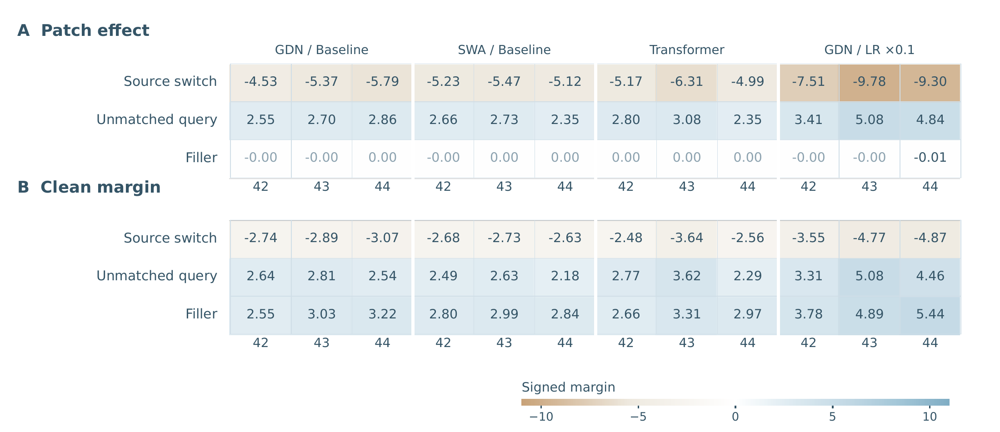

*Query controls: signed effects and clean margins.* [Vector PDF](query-controls.pdf)

**Query-association controls by run.** [CSV](query-controls.csv)

| Model | Run | Layer | Control | Prompts | Signed effect | Clean margin |
| --- | --- | --- | --- | --- | --- | --- |
| GDN / early LR ×0.1 | 42 | 7 | Source switch | 200 | -7.514385 | -3.547684 |
| GDN / early LR ×0.1 | 42 | 7 | Unmatched query | 200 | 3.413649 | 3.308050 |
| GDN / early LR ×0.1 | 42 | 7 | Filler perturbation | 200 | -0.001492 | 3.779467 |
| GDN / early LR ×0.1 | 43 | 7 | Source switch | 200 | -9.784728 | -4.773087 |
| GDN / early LR ×0.1 | 43 | 7 | Unmatched query | 200 | 5.078425 | 5.077450 |
| GDN / early LR ×0.1 | 43 | 7 | Filler perturbation | 200 | -0.004364 | 4.893390 |
| GDN / early LR ×0.1 | 44 | 7 | Source switch | 200 | -9.304043 | -4.871996 |
| GDN / early LR ×0.1 | 44 | 7 | Unmatched query | 200 | 4.838954 | 4.461815 |
| GDN / early LR ×0.1 | 44 | 7 | Filler perturbation | 200 | -0.005048 | 5.435597 |
| GDN baseline | 42 | 3 | Source switch | 200 | -4.533950 | -2.741778 |
| GDN baseline | 42 | 3 | Unmatched query | 200 | 2.547258 | 2.639873 |
| GDN baseline | 42 | 3 | Filler perturbation | 200 | -0.001137 | 2.547714 |
| GDN baseline | 43 | 3 | Source switch | 200 | -5.374037 | -2.887168 |
| GDN baseline | 43 | 3 | Unmatched query | 200 | 2.696593 | 2.805459 |
| GDN baseline | 43 | 3 | Filler perturbation | 200 | -0.000345 | 3.033023 |
| GDN baseline | 44 | 3 | Source switch | 200 | -5.787158 | -3.067984 |
| GDN baseline | 44 | 3 | Unmatched query | 200 | 2.855421 | 2.541496 |
| GDN baseline | 44 | 3 | Filler perturbation | 200 | 0.002115 | 3.216968 |
| SWA baseline | 42 | 3 | Source switch | 200 | -5.228091 | -2.675532 |
| SWA baseline | 42 | 3 | Unmatched query | 200 | 2.661838 | 2.485953 |
| SWA baseline | 42 | 3 | Filler perturbation | 200 | -0.001225 | 2.803773 |
| SWA baseline | 43 | 3 | Source switch | 200 | -5.467401 | -2.731477 |
| SWA baseline | 43 | 3 | Unmatched query | 200 | 2.728702 | 2.625663 |
| SWA baseline | 43 | 3 | Filler perturbation | 200 | 0.003486 | 2.991880 |
| SWA baseline | 44 | 3 | Source switch | 200 | -5.124694 | -2.627593 |
| SWA baseline | 44 | 3 | Unmatched query | 200 | 2.353484 | 2.180641 |
| SWA baseline | 44 | 3 | Filler perturbation | 200 | 0.001390 | 2.836335 |
| Transformer | 42 | 6 | Source switch | 200 | -5.169070 | -2.482256 |
| Transformer | 42 | 6 | Unmatched query | 200 | 2.804946 | 2.770204 |
| Transformer | 42 | 6 | Filler perturbation | 200 | 0.001740 | 2.662822 |
| Transformer | 43 | 7 | Source switch | 200 | -6.311495 | -3.641275 |
| Transformer | 43 | 7 | Unmatched query | 200 | 3.084381 | 3.624437 |
| Transformer | 43 | 7 | Filler perturbation | 200 | 0.001637 | 3.306856 |
| Transformer | 44 | 6 | Source switch | 200 | -4.989057 | -2.555081 |
| Transformer | 44 | 6 | Unmatched query | 200 | 2.350471 | 2.287946 |
| Transformer | 44 | 6 | Filler perturbation | 200 | 0.000026 | 2.974430 |

## S3. Selection and source-key paths

### Fixed-value swaps identify selection-dominated receivers

At a receiver, write the pre-projection query attention output as PV. Record clean (P_c,V_c) and key-exchange-donor (P_d,V_d) states. In a clean recipient, replace the query output with P_dV_c (pattern only), P_cV_d (value only), or P_dV_d (joint), apply the normal output projection, and recompute the remaining model. Each effect subtracts that margin from m(P_cV_c).

The pattern-only effect relocates from L3 to L7 after early LR reduction in both hybrids, while the value-only effect stays near zero. Transformer L6/L7 also show selection-dominated effects. The stronger pattern-effect receiver agrees with the stronger query-update Matching receiver in every tested run. Entries are three-run mean ± sample SD; each condition uses 200 prompts.

**Fixed-value attention-selection effects.** [CSV](fixed-values.csv)

| Model | Receiver | Pattern only | Value only | Pattern + value |
| --- | --- | --- | --- | --- |
| GDN / Baseline | L3 | 5.85 ± 0.45 | 0.00 ± 0.05 | 5.89 ± 0.41 |
| GDN / Baseline | L7 | 1.32 ± 0.39 | -0.01 ± 0.01 | 1.31 ± 0.39 |
| GDN / LR ×0.1 | L3 | 0.02 ± 0.07 | -0.02 ± 0.12 | 0.06 ± 0.11 |
| GDN / LR ×0.1 | L7 | 9.16 ± 0.95 | 0.01 ± 0.02 | 9.21 ± 0.95 |
| SWA / Baseline | L3 | 5.34 ± 0.21 | 0.00 ± 0.00 | 5.38 ± 0.22 |
| SWA / Baseline | L7 | 0.31 ± 0.06 | 0.01 ± 0.00 | 0.32 ± 0.06 |
| SWA / LR ×0.1 | L3 | 0.02 ± 0.03 | -0.02 ± 0.02 | 0.03 ± 0.07 |
| SWA / LR ×0.1 | L7 | 8.14 ± 1.33 | 0.06 ± 0.03 | 8.20 ± 1.36 |
| Transformer | L6 | 4.24 ± 1.78 | 0.00 ± 0.02 | 4.26 ± 1.72 |
| Transformer | L7 | 2.40 ± 2.84 | -0.01 ± 0.00 | 2.38 ± 2.84 |

### The sender perturbation propagates through the source key

The path experiment follows the Carrying perturbation into a candidate receiver:

1. Cache clean receiver-source K_c,V_c and clean margin m_c.
2. Insert the donor Carrying update at the historical value; cache K_p,V_p and perturbed margin m_p.
3. Transfer K_p, V_p, or both into a **clean** recipient to measure channel-specific propagation losses from m_c.
4. In the **sender-patched** run, restore K_c at the historical source and measure recovery m_restored−m_p.
5. For the off-site comparison, add the same repair increment K_c−K_p at another visible historical position.

K-only transfer closely reproduces full-path loss at the original and relocated hybrid routes, while V-only transfer has small effects. The complete per-run table makes this key-composition pattern visible across both architectures.

**Channel-specific propagation.** [CSV](path-channels.csv)

| Model | Route | Run | Full-path loss | K | V | K+V | K/full |
| --- | --- | --- | --- | --- | --- | --- | --- |
| GDN / LR ×0.1 | 6→7 | 42 | 3.162 | 3.164 | -0.039 | 3.162 | 1.001 |
| GDN / LR ×0.1 | 6→7 | 43 | 3.741 | 3.738 | 0.031 | 3.741 | 0.999 |
| GDN / LR ×0.1 | 6→7 | 44 | 4.355 | 4.366 | 0.000 | 4.355 | 1.003 |
| GDN hybrid | 2→3 | 42 | 2.236 | 2.165 | 0.025 | 2.166 | 0.969 |
| GDN hybrid | 2→3 | 43 | 2.645 | 2.637 | -0.028 | 2.637 | 0.997 |
| GDN hybrid | 2→3 | 44 | 2.317 | 2.312 | -0.005 | 2.313 | 0.998 |
| SWA hybrid | 2→3 | 42 | 2.196 | 2.196 | -0.012 | 2.195 | 1.000 |
| SWA hybrid | 2→3 | 43 | 2.648 | 2.647 | -0.064 | 2.646 | 0.999 |
| SWA hybrid | 2→3 | 44 | 2.046 | 2.045 | 0.011 | 2.045 | 1.000 |
| SWA / LR ×0.1 | 6→7 | 42 | 3.585 | 3.585 | 0.050 | 3.585 | 1.000 |
| SWA / LR ×0.1 | 6→7 | 43 | 3.213 | 3.209 | 0.064 | 3.213 | 0.999 |
| SWA / LR ×0.1 | 6→7 | 44 | 2.637 | 2.635 | 0.020 | 2.637 | 0.999 |

Convolution removal and early lag-one suppression retain the same key-dominated propagation: across their six runs, K-only loss differs from full-path loss by at most 0.015 and |V-only loss|≤0.050. Correct-source K restoration recovers the affected prediction. The two 318M rows trace the same sender into two receivers in run 44, showing source-key dependence across multiple global stages. Brackets give paired 95% bootstrap intervals from 10,000 resamples; specificity is source-key minus off-site recovery.

**Source-key restoration and paired uncertainty.** [CSV](path-restoration.csv)

| Condition / run | Route | Full-path loss | K-only | V-only | Off-site recovery | K recovery [95% CI] | Specificity [95% CI] |
| --- | --- | --- | --- | --- | --- | --- | --- |
| No convolution / 42 | L5→L7 | 2.766 | 2.770 | -0.018 | -0.493 | 2.78 [2.42,3.17] | 3.27 [2.82,3.77] |
| No convolution / 43 | L4→L7 | 1.751 | 1.747 | -0.012 | -1.678 | 1.76 [1.50,2.03] | 3.43 [2.93,3.96] |
| No convolution / 44 | L4→L7 | 3.023 | 3.020 | -0.002 | -1.861 | 3.02 [2.61,3.44] | 4.88 [4.19,5.61] |
| Early lag-1 mask / 42 | L6→L7 | 4.176 | 4.180 | 0.001 | -1.392 | 4.17 [3.71,4.65] | 5.57 [4.94,6.21] |
| Early lag-1 mask / 43 | L2→L3 | 3.932 | 3.917 | 0.050 | -3.539 | 3.81 [3.39,4.22] | 7.34 [6.64,8.05] |
| Early lag-1 mask / 44 | L6→L7 | 2.284 | 2.285 | -0.001 | -0.376 | 2.28 [1.98,2.60] | 2.66 [2.30,3.03] |
| 318M Baseline / 44 | L6→L11 | 2.216 | 0.903 | -0.022 | -0.064 | 0.51 [0.40,0.62] | 0.57 [0.45,0.70] |
| 318M Baseline / 44 | L6→L7 | 2.216 | 1.723 | 0.026 | -0.267 | 1.33 [1.17,1.51] | 1.60 [1.41,1.80] |

## S4. Source access and Copying

### Retrieval depends on access to the prepared source

Deleting the correct source at the tested receiver strongly reduces the output margin, while distractor, off-site, and random-source deletions have effects near zero. This holds for both the original baseline route and the route after early LR reduction. Each row uses 200 paired prompts.

**Source-deletion effects.** [CSV](source-deletion.csv)

| Model | Run | Correct source | Distractor | Off-site | Random |
| --- | --- | --- | --- | --- | --- |
| GDN Early LR reduction | 42 | 3.77543 | -0.01371 | -0.00193 | -0.00095 |
| GDN Early LR reduction | 43 | 4.59043 | -0.01569 | -0.00366 | -0.00306 |
| GDN Early LR reduction | 44 | 5.20782 | -0.02279 | -0.00230 | -0.00068 |
| GDN Baseline | 42 | 3.02540 | -0.00465 | -0.00123 | -0.00107 |
| GDN Baseline | 43 | 3.40174 | -0.00147 | 0.00153 | 0.00079 |
| GDN Baseline | 44 | 3.12901 | -0.00465 | -0.00075 | 0.00075 |

### A factorial intervention connects preparation, access, and transmission

We cross the sender update (clean/donor), the query-to-source edge (open/closed), and the source value (clean/distractor). Closing the edge sets its attention probability to zero at the tested receiver and renormalizes remaining causal weights within each head. With b,v=0 for clean states and 1 for donor/distractor states:

```text
Carrying effect(e) = m(0,e,0) − m(1,e,0)
Copying effect(e)  = m(0,e,0) − m(0,e,1)
```

At principal routes, closing the source edge strongly reduces both effects. Testing a later receiver in a shallow-route hybrid leaves the earlier route available and preserves much of the Carrying effect. Thus the interaction identifies **which receiver-source edge** uses the prepared information. Each row reports one checkpoint/run, with 200 prompts per factorial condition. The three 318M baseline 30K rows follow run order 42/43/44; its 50K row follows run 42. Other rows retain their individual archived experiments.

**Conditional Carrying and Copying effects.** [CSV](factorial.csv)

| Model / step | Sender | Receiver | Carrying: open | Carrying: closed | Copying: open | Copying: closed |
| --- | --- | --- | --- | --- | --- | --- |
| 318M / Baseline / 30K | 6 | 7 | 2.197 | 0.177 | 3.303 | -0.003 |
| 318M / Baseline / 50K | 6 | 7 | 1.706 | 0.137 | 2.624 | -0.002 |
| 318M / Baseline / 30K | 10 | 11 | 1.747 | 0.000 | 4.441 | 0.001 |
| 318M / Baseline / 30K | 6 | 7 | 2.135 | 0.449 | 2.637 | -0.011 |
| GDN / LR ×0.1 / 30K | 6 | 7 | 3.387 | 0.000 | 7.044 | 0.000 |
| GDN hybrid / 30K | 2 | 7 | 2.623 | 2.152 | 0.978 | 0.000 |
| GDN / Enriched text / 30K | 2 | 7 | 2.869 | 2.729 | 0.280 | 0.000 |
| GDN / Natural text / 30K | 2 | 7 | 2.570 | 2.102 | 0.974 | 0.000 |
| Transformer / Enriched text / 30K | 5 | 6 | 2.279 | 0.007 | 4.673 | -0.003 |
| Transformer / Natural text / 30K | 5 | 6 | 3.212 | 0.023 | 6.115 | -0.002 |
| GDN / Formation baseline / 30K | 2 | 3 | 2.564 | 0.085 | 4.731 | 0.003 |
| GDN / LR ×0.1 (formation) / 30K | 6 | 7 | 3.375 | 0.000 | 7.078 | 0.000 |
| Transformer / 30K | 5 | 6 | 2.987 | 0.019 | 5.790 | -0.002 |

### Graded interventions reveal the preparation–access interaction

The two-dimensional GDN baseline experiment varies sender-patch strength and edge suppression over {0, 0.25, 0.5, 1}, using 60 prompts per cell in each of three runs. As edge suppression increases, the full-sender contrast falls from 2.710±0.083 to 0.026±0.039. The graded response connects upstream preparation continuously to access at L2→L3, complementing the binary factorial comparison.

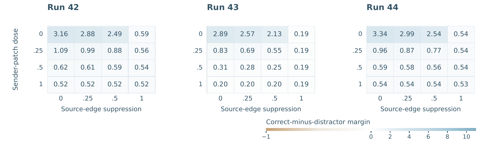

*GDN sender × source-edge dose interaction, 60 prompts per cell.* [Vector PDF](sender-edge-dose.pdf)

**Full-sender contrast by edge-suppression dose.** [CSV](dose-contrasts.csv)

| Edge suppression | Run 42 | Run 43 | Run 44 | Mean ± sample SD |
| --- | --- | --- | --- | --- |
| 0.0 | 2.63350 | 2.69717 | 2.79841 | 2.710 ± 0.083 |
| 0.25 | 2.35465 | 2.37077 | 2.45442 | 2.393 ± 0.054 |
| 0.5 | 1.96982 | 1.93193 | 1.99950 | 1.967 ± 0.034 |
| 1.0 | 0.07041 | 0.00166 | 0.00513 | 0.026 ± 0.039 |

The [full 16-cell grids for all three runs](sender-edge-dose.csv) retain clean and partially intervened margins. Sender contrast at a fixed edge dose is m(a=0,b)−m(a=1,b).

## S5. Architecture and training shape allocation

### Lag-one support has an early allocation role

Convolution width two retains the current token and lag one; removing convolution removes the short-convolution operation. Selective lag-one and lag-two masks change the corresponding channel. Early lag-one suppression redirects two runs to L6→L7, while early lag-two and late lag-one suppression retain L2→L3 in all three runs. The trajectories show how these timing and offset conditions develop through training.

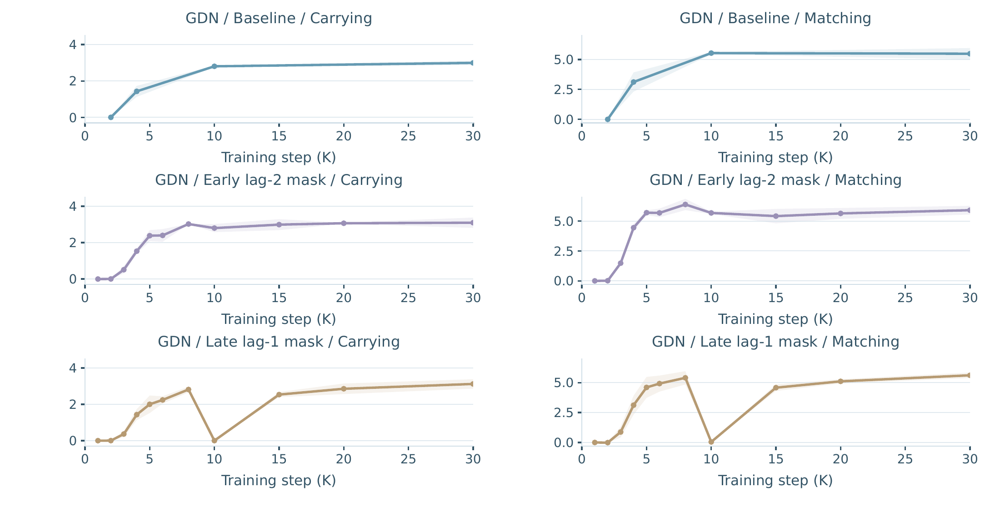

*Selective lag-mask trajectories: mean and sample SD.* [Vector PDF](selective-trajectories.pdf)

**Offset and timing determine endpoint allocation.** [CSV](timing.csv)

| Condition | Carrying layers (42/43/44) | Matching layers (42/43/44) |
| --- | --- | --- |
| Baseline | L2 / L2 / L2 | L3 / L3 / L3 |
| Lag-1 masked early | L6 / L2 / L6 | L7 / L3 / L7 |
| Lag-2 masked early | L2 / L2 / L2 | L3 / L3 / L3 |
| Lag-1 masked late | L2 / L2 / L2 | L3 / L3 / L3 |

### Moving global layers moves the preferred route

Moving the global receivers from L3/L7 to L1/L5 concentrates peak Carrying/Matching at L4→L5 in all three runs. The full profiles show that allocation follows the available global receivers together with their upstream support. The associated natural-text comparison appears in S8.

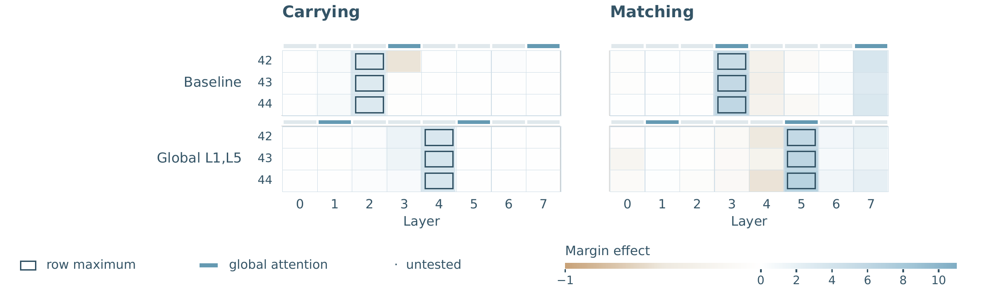

*Full-layer profiles after shifting the global receivers.* [Vector PDF](shifted-layout.pdf)

### Early learning also reorganizes homogeneous Transformers

The layout-matched Transformer intervention reduces LR at L0–2/L4–6. Auxiliary run-42 interventions target L0–5, L6–7, all eight layers, or six randomly selected layers; their peak Carrying→Matching coordinates are respectively L6→L7, L4→L5, L5→L6, and L3→L4. These profiles demonstrate that allocation responds to early learning conditions even when all blocks have full attention.

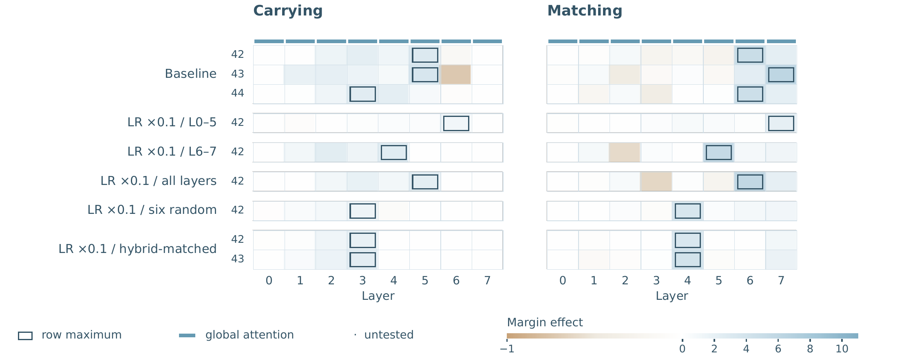

*Full-layer Transformer profiles under early LR interventions.* [Vector PDF](transformer-lr.pdf)

A local-head intervention provides a complementary architectural bias: H0 in the selected layers attends only to the current token and a specified predecessor offset, while other heads keep full causal attention. A persistent lag-one constraint produces peak Carrying at L2 in all three runs. Removing that constraint after 3K steps gives more varied endpoint locations. The complete schedules below connect persistent local access and temporary early support to the resulting allocation; natural-text outcomes are in S8.

**Transformer local-head schedules and peak Carrying.** [CSV](local-heads.csv)

| Condition | Constrained layers | Active interval | Carrying layers (42/43/44) |
| --- | --- | --- | --- |
| Baseline | None | None | L5 / L5 / L3 |
| Lag-1 persistent | L0–L5 | Train and evaluation | L2 / L2 / L2 |
| Lag-1 early | L0–L5 | First 3K steps | L2 / L4 / L3 |
| Lag-1 all-layer early | L0–L7 | First 3K steps | L2 |
| Lag-2 early | L0–L5 | First 3K steps | L3 / L4 / L3 |

### Four global stages support a wider range of allocations

The 16-layer, approximately 318M GDN hybrid has full attention at L3/L7/L11/L15 and efficient groups L0–2, L4–6, L8–10, and L12–14. The complete sweep spans 47 model/run rows. Unless a row states otherwise, LR reduction means ×0.1 during the first 3K steps. Outlines mark measured maxima, dots mark untested coordinates, and rails mark global layers.

Different interventions favor early, intermediate, or late routes. For the nonadjacent-group comparisons, LR reduction at L0–2/L8–10 gives L6→L7 in all three runs; reduction at L4–6/L12–14 gives L2→L3, L10→L11, and L2→L3 in run order 42/43/44. This contrast ties run-to-run allocation differences to the specific support pattern. Some peak pairs span global stages, consistent with the multistage restoration results in S3.

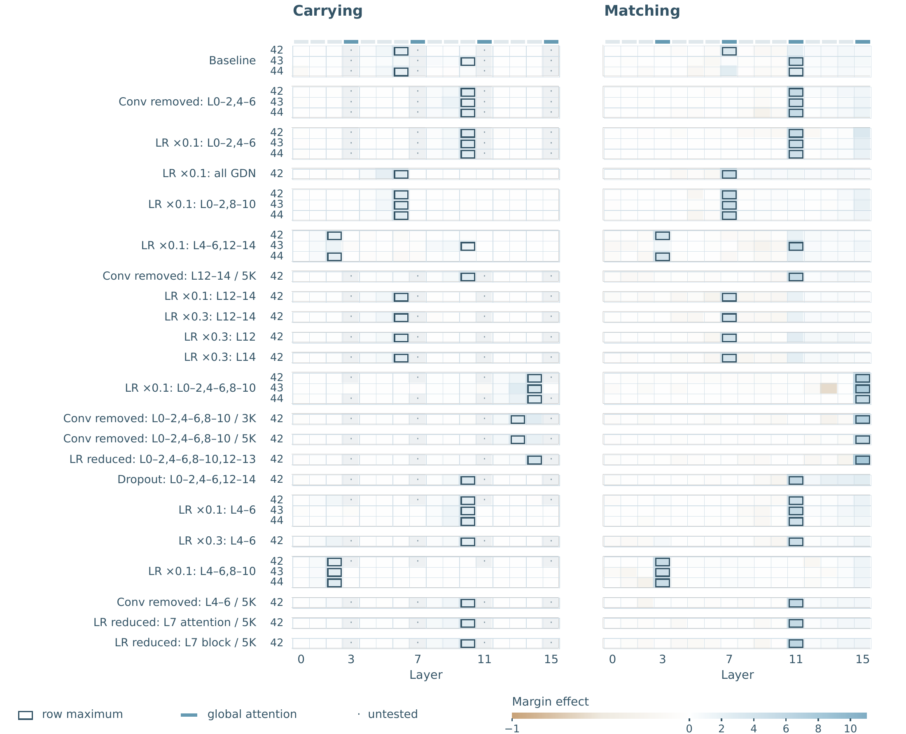

*318M allocation sweep, part 1 of 2.* [Vector PDF](scale-allocation-1.pdf)

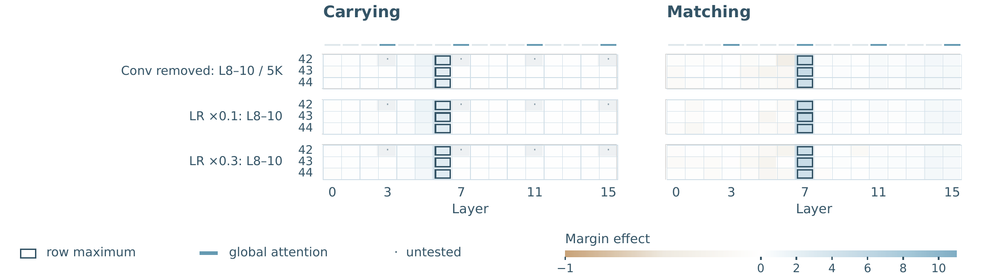

*318M allocation sweep, part 2 of 2; shared scale and coordinates.* [Vector PDF](scale-allocation-2.pdf)

## S6. Circuit formation through training

### Full-layer trajectories connect architecture and training evidence

The architecture–data comparison evaluates checkpoints at 0.5K, 1K, 1.5K, 2K, 2.5K, 3K, 4K, 5K, 8K, 10K, 15K, 20K, and 30K. The SWA window comparison evaluates 1K–10K in 1K increments and then 15K/20K/30K. Each condition uses three runs, all eight layers, and 200 prompts per probe condition. Matching uses the historical-key-exchange query-update intervention throughout.

The main formation curves follow each run's endpoint-selected layer at every checkpoint; fixed-site comparisons use the same physical coordinates (Carrying L2 and Matching L3), with additional Transformer receivers showing its deeper query response. The heatmaps below show all measured layers and checkpoints on a common signed scale. Induction enrichment advances Transformer Carrying, whereas natural/enriched GDN hybrid trajectories rise in a similar early interval. Architectural support and repeated predictable training evidence therefore provide two ways to advance functional circuit formation.

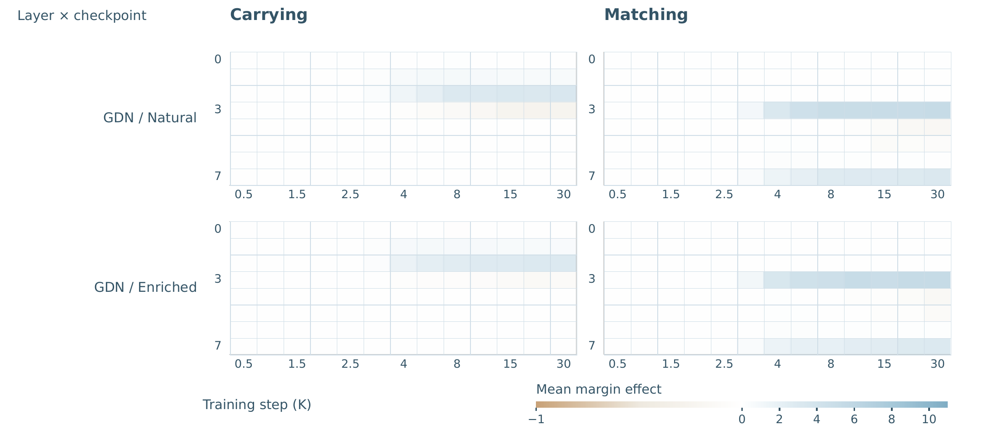

*GDN natural and enriched text: all layers and checkpoints.* [Vector PDF](formation-gdn.pdf)

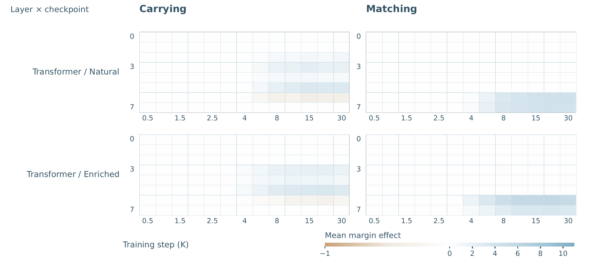

*Transformer natural and enriched text: all layers and checkpoints.* [Vector PDF](formation-transformer.pdf)

### Narrow windows establish functional responses earlier

Onset is the first of **two consecutive** measured checkpoints at or above a threshold; the table reports the interval between the preceding checkpoint and this first crossing. Each trajectory follows its fixed endpoint-selected layer. Shared intervals apply to all three runs; semicolon-separated intervals follow runs 42/43/44. Units are thousands of training steps.

For Carrying thresholds 0.1/0.25/0.5, window two crosses in (1,2]K and windows eight/sixteen in (2,3]K. All three share (2,3]K at threshold 1. For Matching, windows two/eight tie at thresholds 0.1/0.25, while window two leads both wider windows at 0.5/1. Thus earlier onset and endpoint strength capture different aspects of circuit development.

**Formation onset intervals (K steps).** [CSV](onset.csv)

| Condition | Readout | Threshold 0.1 | Threshold 0.25 | Threshold 0.5 | Threshold 1 |
| --- | --- | --- | --- | --- | --- |
| SWA window 2 | Carrying | (1,2] | (1,2] | (1,2] | (2,3] |
| SWA window 2 | Matching | (1,2] | (1,2] | (1,2] | (1,2] |
| SWA window 8 | Carrying | (2,3] | (2,3] | (2,3] | (2,3] |
| SWA window 8 | Matching | (1,2] | (1,2] | (2,3] | (2,3] |
| SWA window 16 | Carrying | (2,3] | (2,3] | (2,3] | (2,3] |
| SWA window 16 | Matching | (2,3] | (2,3] | (2,3] | (2,3] |
| GDN / Natural | Carrying | (2.5,3] | (3,4]; (2.5,3]; (2.5,3] | (3,4] | (3,4] |
| GDN / Natural | Matching | (2.5,3]; (2,2.5]; (2,2.5] | (2.5,3] | (3,4]; (2.5,3]; (2.5,3] | (3,4]; (2.5,3]; (2.5,3] |
| GDN / Enriched | Carrying | (2.5,3] | (2.5,3] | (3,4] | (3,4] |
| GDN / Enriched | Matching | (2.5,3]; (2,2.5]; (2,2.5] | (2.5,3] | (2.5,3] | (3,4]; (2.5,3]; (2.5,3] |
| Transformer / Natural | Carrying | (3,4]; (3,4]; (4,5] | (3,4]; (4,5]; (5,8] | (4,5]; (4,5]; (5,8] | (4,5]; (4,5]; (5,8] |
| Transformer / Natural | Matching | (3,4] | (3,4] | (3,4]; (3,4]; (4,5] | (4,5] |
| Transformer / Enriched | Carrying | (3,4] | (3,4] | (3,4]; (4,5]; (3,4] | (4,5] |
| Transformer / Enriched | Matching | (3,4] | (3,4] | (3,4] | (3,4]; (4,5]; (3,4] |

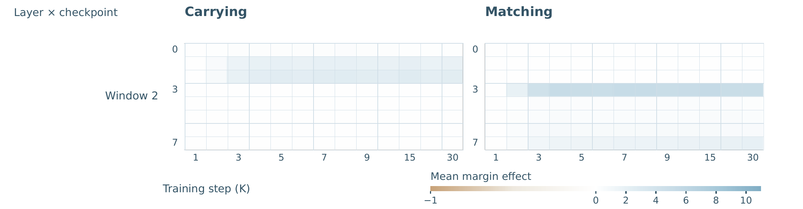

*SWA window 2: all layers and checkpoints.* [Vector PDF](formation-swa2.pdf)

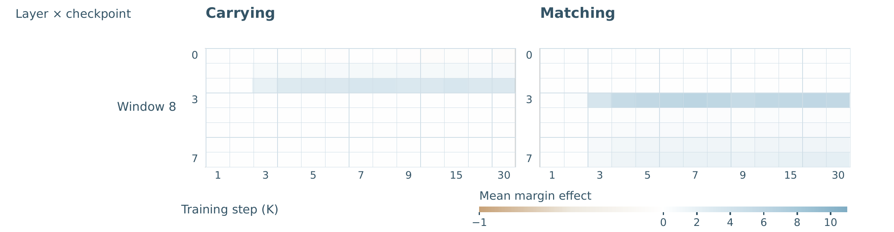

*SWA window 8: all layers and checkpoints.* [Vector PDF](formation-swa8.pdf)

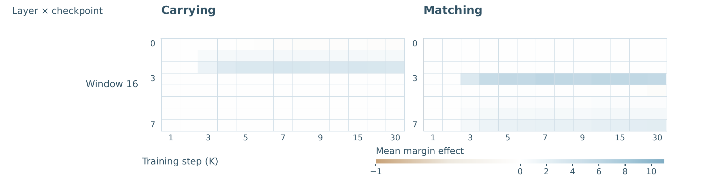

*SWA window 16: all layers and checkpoints.* [Vector PDF](formation-swa16.pdf)

At 30K, L2 Carrying is 2.43±0.14 for window two, 3.16±0.17 for window eight, and 3.24±0.24 for window sixteen. Wider windows develop stronger late Carrying despite window two's earlier threshold crossings. The complete trajectory plot retains every measured checkpoint and three-run sample-SD bands.

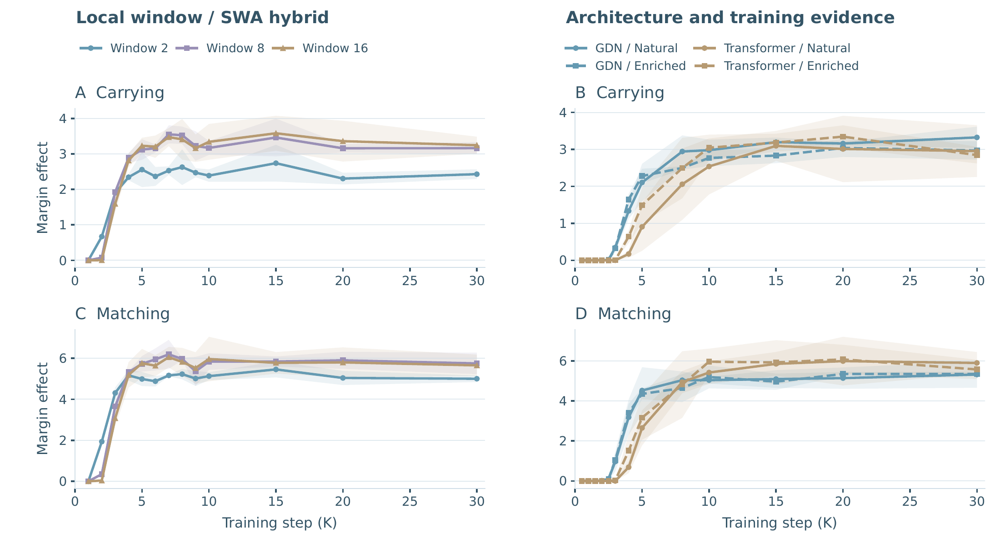

*Complete window and architecture–data formation trajectories through 30K steps.* [Vector PDF](formation-complete.pdf)

## S7. Pretrained Qwen localization and restoration

### Localization inputs and grouped-query structure

Qwen3-4B has 36 full-attention layers, 32 query heads, and eight KV heads. Qwen3.5-4B has 32 language-model layers with layout [GDN³, FullAttn]⁸, width 2,560, and convolution kernel four. Its global layers have 16 query heads and four KV heads; GDN layers use 16 QK heads and 32 value heads. Measurements use the released checkpoints and zero-based coordinates.

Fixed-token localization uses a fixed key–value tuple with sampled background filler: Qwen3 token IDs 94723/91807/96498/97535 and a 4,868-ID filler pool; Qwen3.5 IDs 199437/166039/217654/227991 and a 32,816-ID pool. Each condition has 200 prompts. Qwen3's strongest Carrying and Matching lie in separated full-attention layers; Qwen3.5's main pair is GDN L18 followed by global L19, with secondary responses deeper in the model.

Fixed-attention Copying concentrates in the retrieval layers identified by Matching. Each KV head serves four query heads. Dominant groups at the main receiver are Qwen3 KV H5 (query H20–H23) and Qwen3.5 KV H3 (query H12–H15). Localization and restoration use separately sampled 200-prompt sets.

### Calibrated inputs make clean solvability explicit

For Qwen3.5 calibration, NumPy seed 42 selects four distinct non-special tokens with IDs in [120000,246000). After stripping tokenizer space markers, eligible vocabulary strings contain at least four ASCII alphabetic characters. A minimum-ID cutoff selects both key/value and filler pools, and the prompt distance parameter is sampled from 100–399. Each pool fixes its sampled key–value identities and uses 200 prompts. Positive clean margin means that the target outranks the designated distractor.

**Qwen3.5 clean-solvability calibration.** [CSV](qwen-calibration.csv)

| Minimum token ID | Pool size | Mean clean margin | Clean-positive fraction |
| --- | --- | --- | --- |
| 120,000 | 32,515 | 5.601 | 100.0% |
| 150,000 | 32,513 | -2.551 | 16.0% |
| 180,000 | 25,461 | 2.089 | 71.0% |
| 200,000 | 17,886 | 1.063 | 89.5% |
| 220,000 | 10,149 | 2.501 | 100.0% |
| 240,000 | 2,455 | 6.732 | 96.5% |

### Source-K restoration recovers the sender-patch loss

The restoration experiment uses the minimum-ID-180000 pool (25,461 IDs) and token tuple 209267/186154/223584/231557. It perturbs the historical-value block update at GDN L18 and restores a clean component at global L19. Since the sender patch changes one position immediately before that receiver, the receiver's pre-attention K changes at that historical position. Q and K restoration occurs after normalization and rotary transformation; V restoration occurs at the projection output.

The full-attention output gate is separate from the FFN gate. Its doubled Q projection splits into query and gate channels, giving output W_O[concat(PV) ⊙ sigmoid(g)]. Gate restoration replaces this g; attention-output and FFN-output restoration replace the respective module outputs.

Source-K recovery nearly matches the sender loss for all prompts and for the fixed clean-positive subset (69% of the 200-prompt parent sample). Attention-output restoration gives similar recovery, while Q/V/gate/FFN restoration produces much smaller changes for this sender perturbation. The absolute clean, patched, and restored margins below show the recovery as well as the component differences. Brackets are archived paired-prompt 95% intervals; the clean-positive summary uses 2,000 bootstrap resamples. Calibration's 71% and restoration's 69% come from their separately sampled prompt sets.

**Qwen3.5 L18→L19 restoration.** [CSV](qwen-components.csv)

| Quantity | All prompts [95% CI] | Clean-positive subset [95% CI] |
| --- | --- | --- |
| Clean margin | 1.850 [1.453,2.268] | 2.956 [2.490,3.462] |
| Sender-patched margin | 0.406 [0.114,0.707] | 1.088 [0.719,1.488] |
| K-restored margin | 1.826 [1.423,2.249] | 2.931 [2.457,3.441] |
| Sender-patch loss | 1.444 [1.270,1.630] | 1.868 [1.655,2.099] |
| K recovery | 1.420 [1.252,1.603] | 1.843 [1.639,2.064] |
| Q recovery | -0.007 [-0.015,-0.001] | -0.010 [-0.021,-0.001] |
| V recovery | -0.009 [-0.018,-0.002] | -0.015 [-0.026,-0.004] |
| Gate recovery | -0.008 [-0.015,-0.001] | -0.011 [-0.022,-0.002] |
| Attention-output recovery | 1.420 [1.249,1.605] | 1.840 [1.629,2.066] |
| FFN-output recovery | 0.028 [0.005,0.052] | 0.033 [0.000,0.067] |

For dose response, interpolate the sender update as u_α=(1−α)u_clean+αu_cf for α∈{0,0.25,0.5,0.75,1}, then RMS-match it to the clean update before insertion. Each input condition reuses its 200 prompts across doses. K and attention-output recovery are measured in each sender-perturbed run. This procedure gives graded recovery with growing sender perturbation, including the common-token condition where perturbed margins remain positive on almost every prompt.

## S8. Natural-text prediction and recall

### Targets and aggregation

Each checkpoint is evaluated on 10,000 1,024-token sequences: 2,000 Wiki, 4,000 Python, and 4,000 Math. Python and Math each comprise two 2,000-sequence partitions from their respective parent dataset. Comparisons reuse sequences and target-selection rules within each evaluation batch.

For target B=x_p with predecessor A=x_(p−1), search the preceding 512-token history. A repeated association has an earlier (A,B) pair. If u distinct tokens have followed A in that history, single-continuation recall has u=1 and multiple-continuation recall has u>1. Distance is predecessor recency d=p−p_A−1, where p_A is the most recent historical predecessor: near 1–20, mid 21–100, far 101–512. Long-range identifier reuse selects Python identifiers with predecessor distance >100. Target groups can overlap.

For selected targets T, PPL=exp(sum of target NLL / |T|). Eight-layer Python/Math results pool NLL and valid-token counts over their two partitions before exponentiating. The 318M export contains two-decimal partition PPLs; equal token counts allow geometric-mean reconstruction of parent-domain PPL. Reported means and sample SD are computed from each run's PPL. Separate evaluation batches retain separate matched baselines.

### Allocation changes accompany distinct prediction profiles

For the eight-layer hybrids, early LR reduction lowers mean Python PPL and raises Wiki PPL; the matched Transformer intervention raises all three domain means. Convolution removal and window size produce additional domain/recall profiles. These comparisons connect altered source preparation and circuit allocation to how a trained model handles competing continuations and natural contexts.

The last two rows in each panel are a **separate three-run Transformer experiment**, pairing persistent lag-one H0 constraints at L0–5 with their own unrestricted baseline. This constraint establishes shallow Carrying and improves Wiki and single-far PPL, while multiple-far and identifier-reuse PPL increase. The comparison distinguishes establishing a local component from its use across prediction settings.

**Eight-layer domain PPL.** [CSV](domain-8layer.csv)

| Model | Variant | Wiki | Python | Math |
| --- | --- | --- | --- | --- |
| SWA | Window 2 | 90.44 ± 0.52 | 22.52 ± 1.27 | 51.96 ± 0.99 |
| SWA | Window 4 | 90.99 ± 0.15 | 24.41 ± 0.77 | 49.04 ± 0.12 |
| SWA | Window 4, LR ×0.1 | 100.58 ± 2.21 | 21.11 ± 2.02 | 49.54 ± 0.29 |
| SWA | Window 8 | 86.54 ± 1.67 | 21.99 ± 0.90 | 47.85 ± 0.07 |
| SWA | Window 16 | 84.96 ± 2.02 | 23.33 ± 1.16 | 46.94 ± 0.16 |
| GDN | Baseline | 85.52 ± 0.92 | 23.79 ± 3.04 | 46.65 ± 0.66 |
| GDN | LR ×0.1 | 93.80 ± 3.01 | 20.64 ± 2.04 | 47.18 ± 0.04 |
| GDN | Conv removed | 90.04 ± 1.34 | 20.88 ± 1.51 | 47.03 ± 0.29 |
| Transformer | Baseline | 98.51 ± 2.41 | 22.69 ± 3.19 | 49.32 ± 0.19 |
| Transformer | LR ×0.1 | 117.63 ± 1.97 | 30.80 ± 4.84 | 56.14 ± 0.35 |
| Transformer | Unrestricted | 98.44 ± 1.20 | 24.21 ± 2.94 | 49.39 ± 0.14 |
| Transformer | Lag-1 heads | 90.89 ± 2.23 | 26.35 ± 2.52 | 48.82 ± 0.52 |

**Eight-layer recall PPL.** [CSV](recall-8layer.csv)

| Model | Variant | Single far | Multiple near | Multiple mid | Multiple far | Identifier reuse |
| --- | --- | --- | --- | --- | --- | --- |
| SWA | Window 2 | 2.26 ± 0.05 | 2.85 ± 0.36 | 14.97 ± 0.60 | 28.99 ± 0.43 | 28.05 ± 2.21 |
| SWA | Window 4 | 2.33 ± 0.06 | 2.86 ± 0.22 | 15.52 ± 1.09 | 26.61 ± 1.18 | 28.31 ± 3.97 |
| SWA | Window 4, LR ×0.1 | 2.64 ± 0.06 | 2.68 ± 0.25 | 12.94 ± 1.70 | 25.63 ± 0.87 | 23.49 ± 2.12 |
| SWA | Window 8 | 2.25 ± 0.07 | 2.78 ± 0.15 | 14.00 ± 0.94 | 24.19 ± 0.96 | 23.54 ± 2.86 |
| SWA | Window 16 | 2.26 ± 0.07 | 3.13 ± 0.34 | 14.31 ± 2.02 | 22.40 ± 2.55 | 20.91 ± 6.76 |
| GDN | Baseline | 2.38 ± 0.04 | 2.75 ± 0.39 | 16.34 ± 1.99 | 25.98 ± 1.23 | 29.00 ± 1.43 |
| GDN | LR ×0.1 | 2.59 ± 0.05 | 2.64 ± 0.27 | 12.52 ± 0.93 | 23.35 ± 0.34 | 21.02 ± 1.60 |
| GDN | Conv removed | 2.70 ± 0.05 | 2.83 ± 0.73 | 12.50 ± 0.28 | 21.75 ± 1.99 | 18.72 ± 4.57 |
| Transformer | Baseline | 2.66 ± 0.04 | 2.59 ± 0.14 | 15.03 ± 1.93 | 25.73 ± 0.29 | 25.01 ± 0.62 |
| Transformer | LR ×0.1 | 3.33 ± 0.04 | 3.24 ± 0.14 | 19.34 ± 2.67 | 33.60 ± 1.41 | 34.86 ± 1.77 |
| Transformer | Unrestricted | 2.62 ± 0.05 | 3.26 ± 1.10 | 14.67 ± 1.81 | 24.95 ± 2.37 | 23.23 ± 6.46 |
| Transformer | Lag-1 heads | 2.51 ± 0.06 | 3.31 ± 0.66 | 17.46 ± 1.76 | 27.09 ± 2.19 | 27.59 ± 5.92 |

### Shifted receivers and matched Transformer seeds

The shifted GDN layout moves full attention from L3/L7 to L1/L5. At 30K, the three-run mean overall PPL changes from 40.17 to 38.08, multiple-far PPL from 25.98 to 23.82, and identifier-reuse PPL from 29.00 to 23.54. The full table reports every recall column from this matched comparison.

**Global-layer layout and recall PPL.** [CSV](layout-recall.csv)

| Model | Variant | Overall | Single far | Multiple near | Multiple mid | Multiple far | Identifier reuse |
| --- | --- | --- | --- | --- | --- | --- | --- |
| GDN | Baseline | 40.17 ± 2.00 | 2.38 ± 0.04 | 2.75 ± 0.39 | 16.34 ± 1.99 | 25.98 ± 1.23 | 29.00 ± 1.43 |
| GDN | Global L1,L5 | 38.08 ± 1.28 | 2.26 ± 0.04 | 2.54 ± 0.01 | 13.49 ± 1.55 | 23.82 ± 1.64 | 23.54 ± 2.93 |

In the two matched Transformer runs, layout-matched LR reduction increases overall, multiple-mid/far, and identifier-reuse PPL. Showing each run preserves the pairing underlying the aggregate Transformer comparison.

**Matched-run Transformer LR comparison.** [CSV](transformer-recall.csv)

| Run | Variant | Overall | Multiple mid | Multiple far | Identifier reuse |
| --- | --- | --- | --- | --- | --- |
| 42 | Baseline | 40.00 | 13.66 | 25.94 | 24.57 |
| 42 | LR ×0.1 | 53.18 | 21.23 | 34.60 | 36.11 |
| 43 | Baseline | 42.93 | 16.39 | 25.53 | 25.45 |
| 43 | LR ×0.1 | 49.04 | 17.45 | 32.60 | 33.60 |

### The four-stage hybrid exhibits domain-specific trade-offs

The common 318M export compares eight configurations at 30K, each with three runs. LR reduction at L4–6 or L0–2/L4–6/L8–10 lowers mean Python PPL; baseline has the lowest mean multiple-far and identifier-reuse PPL. Other interventions favor Wiki, Math, or single-continuation recall. The full domain and recall panels show how early, intermediate, and late allocations accompany different downstream profiles.

**318M domain PPL: common export.** [CSV](domain-318m.csv)

| Variant | Layers | Wiki | Python | Math |
| --- | --- | --- | --- | --- |
| Baseline | All | 71.94 ± 1.73 | 23.18 ± 0.62 | 43.80 ± 0.73 |
| LR ×0.1 | 0–2,4–6 | 74.72 ± 1.49 | 23.71 ± 0.23 | 45.59 ± 0.82 |
| LR ×0.1 | 0–2,8–10 | 72.63 ± 0.68 | 23.81 ± 3.31 | 44.32 ± 0.50 |
| LR ×0.1 | 0–2,4–6,8–10 | 81.92 ± 0.36 | 22.28 ± 0.57 | 46.59 ± 0.15 |
| LR ×0.1 | 4–6 | 72.98 ± 1.83 | 21.81 ± 1.51 | 43.89 ± 0.55 |
| LR ×0.1 | 4–6,8–10 | 72.79 ± 2.25 | 23.58 ± 1.37 | 44.06 ± 0.25 |
| LR ×0.1 | 8–10 | 71.08 ± 1.00 | 23.27 ± 1.53 | 43.62 ± 0.25 |
| NoConv (5K) | 8–10 | 70.58 ± 0.40 | 23.84 ± 1.37 | 43.68 ± 0.19 |

**318M recall PPL: common export.** [CSV](recall-318m.csv)

| Variant | Layers | Single far | Multiple near | Multiple mid | Multiple far | Identifier reuse |
| --- | --- | --- | --- | --- | --- | --- |
| Baseline | All | 2.32 ± 0.07 | 3.36 ± 0.37 | 14.54 ± 0.97 | 20.85 ± 1.01 | 20.45 ± 2.73 |
| LR ×0.1 | 0–2,4–6 | 2.37 ± 0.08 | 3.09 ± 0.36 | 15.80 ± 1.18 | 23.75 ± 2.05 | 27.23 ± 4.26 |
| LR ×0.1 | 0–2,8–10 | 2.32 ± 0.03 | 3.27 ± 0.81 | 15.78 ± 1.38 | 23.76 ± 0.38 | 27.63 ± 1.09 |
| LR ×0.1 | 0–2,4–6,8–10 | 2.59 ± 0.06 | 2.75 ± 0.23 | 14.64 ± 0.68 | 24.22 ± 1.56 | 27.69 ± 3.64 |
| LR ×0.1 | 4–6 | 2.33 ± 0.02 | 3.04 ± 0.56 | 14.29 ± 0.99 | 22.00 ± 1.20 | 24.30 ± 3.29 |
| LR ×0.1 | 4–6,8–10 | 2.43 ± 0.07 | 3.16 ± 0.10 | 15.44 ± 1.57 | 23.91 ± 1.57 | 26.47 ± 3.49 |
| LR ×0.1 | 8–10 | 2.26 ± 0.03 | 3.28 ± 0.61 | 14.69 ± 0.94 | 21.63 ± 0.86 | 22.85 ± 2.78 |
| NoConv (5K) | 8–10 | 2.33 ± 0.03 | 3.71 ± 1.18 | 14.82 ± 1.68 | 22.20 ± 2.62 | 24.73 ± 7.89 |

Two further replicated allocations have recall measurements from an **earlier evaluation batch**. Their matched baseline is shown below, and comparisons stay within this table. Both interventions change the recall profile relative to that baseline, with higher multiple-far and identifier-reuse PPL.

**318M recall PPL: earlier matched export.** [CSV](recall-318m-earlier.csv)

| Variant | Layers | Single far | Multiple near | Multiple mid | Multiple far | Identifier reuse |
| --- | --- | --- | --- | --- | --- | --- |
| Baseline | All | 2.58 ± 0.10 | 3.47 ± 0.38 | 14.00 ± 0.97 | 21.97 ± 1.11 | 21.17 ± 3.08 |
| Conv removed | 0–2,4–6 | 2.55 ± 0.07 | 3.10 ± 0.44 | 14.47 ± 1.19 | 23.07 ± 0.89 | 26.45 ± 2.51 |
| LR ×0.1 | 4–6,12–14 | 2.60 ± 0.16 | 3.13 ± 0.26 | 14.18 ± 0.74 | 23.22 ± 0.70 | 26.14 ± 1.21 |

### Natural-text head interventions connect retrieval to prediction

Head ablation measures ΔNLL=NLL_off−NLL_clean over 200 sequences per condition. The selected heads contribute more than comparison heads to overall prediction, distant multiple-continuation recall, and identifier reuse, and rank first in their layers for overall NLL damage in the plotted comparisons. Matched-head synthetic measurements put the peak Matching and Copying at the same head in all 11 plotted rows. For GDN baseline run 44 at L3, the source-attention maximum is H5 and the Matching/Copying maximum is H6; natural-text ablation uses the archived H5-versus-H2 comparison. These coordinates distinguish attention mass, causal association readouts, and the selected natural-text intervention.

## S9. Alternative receivers

To examine which receivers support the historical-source pathway, compare eight-layer GDN-only, GDN–SWA, SWA-only, and GDN–FullAttn models at 30K/run 42. Local receivers yield weak historical-source probe effects; GDN-only and GDN–SWA also have substantially higher distant recall PPL. In GDN-only, transferring the **query recurrent state** changes the retrieved association, identifying retrieval from current recurrent state as a different organization of the association. Dashes mark unmeasured PPL entries.

**Historical-source probes and local receivers.** [CSV](local-receivers.csv)

| Model | Peak Carrying | Peak Matching | Multiple-far PPL | Identifier PPL |
| --- | --- | --- | --- | --- |
| GDN–FullAttn | 2.60 | 4.99 | 24.79 | 27.35 |
| Pure GDN | <0.02 | 0.37 | 66.37 | 119.23 |
| GDN–SWA (16) | <0.02 | 0.36 | 63.41 | 114.04 |
| SWA-only (4) | 0.00 | 0.05 | — | — |

Sparse global access retains the historical-source division. GDN–DSA is trained from random initialization for 30K/run 42 with width 512, eight heads, and layout [GDN³, DSA]². Receivers L3/L7 select the top 128 candidates across the causal context. Carrying peaks at GDN L2 and Matching at sparse receiver L7. Compared with the matched full-attention model, overall and identifier-reuse PPL are lower, while single-far and multiple-far PPL are higher. This result connects the availability of global source access to the circuit while distinguishing its natural-text outcomes across target types.

**Sparse global receiver comparison.** [CSV](sparse-receivers.csv)

| Model | Peak Carrying | Peak Matching | Overall PPL | Single-far PPL | Multiple-far PPL | Identifier PPL |
| --- | --- | --- | --- | --- | --- | --- |
| GDN–FullAttn | 2.60 | 4.99 | 38.21 | 2.35 | 24.79 | 27.35 |
| GDN–DSA | 1.70 | 3.11 | 31.09 | 3.08 | 27.42 | 24.45 |

## Supplementary files

The [supplementary directory](./) contains 13 figure panels as PNGs and original vector PDFs, 23 table CSVs, and the full sender×edge dose grids with the original sample counts. All links are repository-relative so the same README and assets are accessible through the anonymous mirror.
